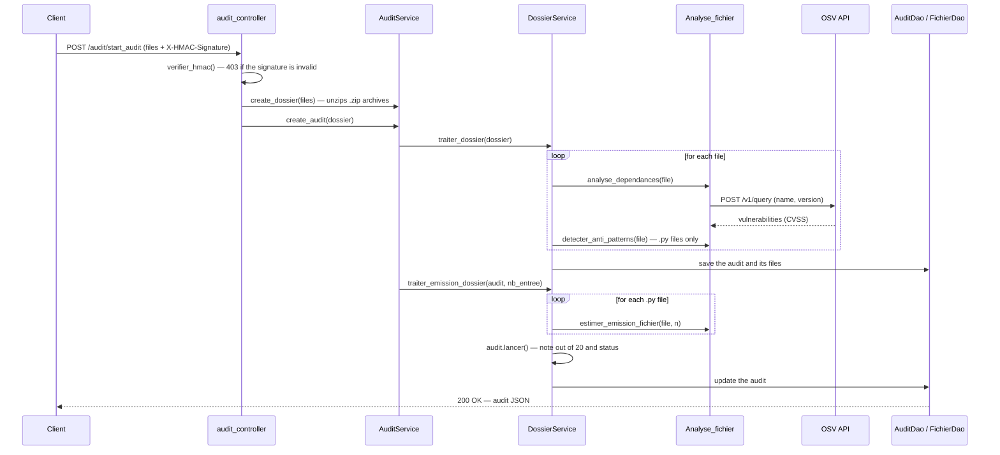

# CleanOps — Backend (developer guide)

The backend is the audit engine of CleanOps: a REST API built with [FastAPI](https://fastapi.tiangolo.com/),
organised in layers, backed by a PostgreSQL database and calling the external [OSV](https://osv.dev/) API.

For installation from scratch and the `.env` file, see the [root README](../README.md).


## :rocket: Run

All commands are run from the **root of the repository**:

- Install all dependencies, including dev tools: `uv sync --project backend --all-extras`
- Launch the API: `uv run --project backend python backend/src/main.py`
- Interactive documentation: `/docs` (Swagger) or `/redoc` on the API URL

:bulb: First launch: call `GET /reset_database` (or click **Réinitialiser la base de données** in the interface) to create the tables and load the demo data.


## :classical_building: Architecture

The code follows a layered architecture: each layer only talks to the one below it.

```text
Frontend / client
      │  HTTP (JSON)
      ▼
controller/        routes: receive the request, return the HTTP response (200, 403, 404…)
      │
      ▼
service/           business logic: orchestrates the audit, calls the DAO and the external API
      │                                   │
      ▼                                   ▼
dao/               SQL queries          OSV API (vulnerabilities)
      │
      ▼
PostgreSQL

business_object/   domain objects used by every layer (Audit, Fichier, Certificat…)
schema/            Pydantic models: exact format of what the API receives and returns
utils/             security (hashing, HMAC), logs, singleton
```

### Main classes

| Layer | Class | Role |
| ----- | ----- | ---- |
| business_object | `Utilisateur` | A user account |
| | `Fichier` | A submitted file: its code, extension, dependencies, AST, score, complexity, emissions |
| | `Dossier` | The set of files submitted together |
| | `Audit` | The result of an analysis: status, score, total emissions |
| | `Dependances`, `Vulnerabilite` | A dependency (name, version) and a vulnerability returned by OSV |
| | `Certificat` | The certificate and its Quality Gate (`calcul_QualityGate`) |
| | `SBOM` | Generates the CycloneDX 1.6 inventory of an audit |
| service | `AuditService` | Entry point of an audit: reads the uploads, unzips archives, builds the `Dossier`, generates the SBOM and the certificate |
| | `DossierService` | Runs the analysis pipeline on every file and saves the audit |
| | `Analyse_fichier` | Static analysis: OSV queries, CVSS score, AST complexity, anti-patterns, CO2 estimation |
| | `UtilisateurService`, `HistoriqueService` | Accounts, login, audit history |
| dao | `AuditDao`, `FichierDao`, `UtilisateurDao` | CRUD operations on the tables |
| | `Manager_db` | Resets the database from the SQL scripts |
| | `DBConnection` | Single PostgreSQL connection (singleton) |
| controller | `audit_controller`, `fichier_controller`, `utilisateur_controller`, `historique_controller` | Routes under `/audit`, `/file`, `/user`, `/historic` |

### Audit flow



Then, on demand:

- `GET /audit/{id}/sbom` → `AuditService.generer_sbom(id)` → `SBOM.generer_sbom(audit)`
- `GET /audit/{id}/certificat` → `AuditService.generer_certificat(id)` → `Certificat.calcul_QualityGate()`, then `Certificat.calcul_cle()` signs it
- `POST /audit/verif_certificat` → `AuditService.verif_certificat(...)` → checks the signature and returns the audit (404 if it is not authentic)


## :gear: How the analyses work

### F1 — HMAC signature (`utils/security.py`)

`preparer_contenu_hmac()` builds a deterministic message from the files sorted by name
(for each file: name length on 8 bytes, name, content length on 8 bytes, content).
`verifier_hmac()` recomputes the HMAC-SHA256 with `HMAC_SECRET_KEY` and compares it with
`hmac.compare_digest`, which is resistant to timing attacks.

### F2 — Dependencies and vulnerabilities (`Fichier`, `Analyse_fichier`)

- Dependencies are extracted from `requirements.txt`, `pyproject.toml`, `uv.lock` (exact versions) and from the `import` statements of `.py` files (standard library excluded).
- Each dependency is sent to OSV; the score of a vulnerability is its CVSS base score (v3 or v4), or a score derived from its severity label.
- The score of a file is its worst vulnerability (0 to 10).
- Only pinned dependencies give a reliable result: without a version, OSV returns the vulnerabilities of every version of the package (a warning is logged).

### F3 — Complexity and emissions (`Analyse_fichier`)

- An `ast.NodeVisitor` measures the maximum nesting depth *k* of `for`/`while` loops: the complexity is estimated as O(n^k).
- Anti-patterns detected: nested loops and recursive functions.
- Emissions, for an input size *n* (500 by default):

  ```text
  operations   = n^k
  time (s)     = operations / machine speed (operations per second)
  energy (kWh) = time × PUISSANCE_MACHINE_W / 3 600 000
  gCO2e        = energy × INTENSITE_CARBONE_G_KWH
  ```

### F4 — SBOM (`business_object/sbom.py`)

CycloneDX 1.6 JSON: each component has a [purl](https://github.com/package-url/purl-spec)
(`pkg:pypi/<name>@<version>`) used as `bom-ref`; names are normalised according to PEP 503;
when a library appears both with and without a version, only the pinned version is kept.

### F5 — Note, Quality Gate and signed certificate

**Note out of 20** (`Audit.lancer()`), the higher the better:

```text
security  = 10 - worst CVSS score of the files          (one critical flaw is enough to lose the points)
sobriety  = max(0, 10 - 1 point per 0.01 gCO2e emitted)
note      = security + sobriety                         (audit "validé" if note > 15)
```

**Quality Gate** (`business_object/certificat.py`):

| Check | Result if it fails |
| ----- | ------------------ |
| The audit is finished (status not `créé` / `échoué`) | `rejeté` |
| Note > `SEUIL_SCORE` (15/20) | `échoué` + reason |

The certificate is `validé` when no reason was found; every reason is listed in `motifs`.

**Signature** (`utils/security.py`): the backend signs `"<audit id>|<delivery date>"` with RSA-PSS
(SHA-256) and the private key `PRIVATE_KEY`; the signature is returned in the `cle` field.
`POST /audit/verif_certificat` checks it with `PUBLIC_KEY`: anyone holding a certificate can prove
that it was really delivered by CleanOps, and gets back the audit it refers to.


## :card_file_box: Database

Created by `data/init_db.sql` in the schema `POSTGRES_SCHEMA` (`project` by default).

| Table | Main columns |
| ----- | ------------ |
| `Utilisateurs` | `id`, `name`, `mot_de_passe` (SHA-256 hash), `email` |
| `Audit` | `id`, `utilisateur_id`, `date_audit`, `statut`, `score` (note /20), `complexite`, `emissionCO2` (gCO2e) |
| `Fichier` | `id`, `audit_id`, `code`, `extension`, `score`, `complexite`, `emissionCO2` |


## :wrench: Environment variables

| Variable | Default | Used by |
| -------- | ------- | ------- |
| `POSTGRES_HOST`, `POSTGRES_PORT`, `POSTGRES_DATABASE`, `POSTGRES_USER`, `POSTGRES_PASSWORD` | — | `DBConnection` |
| `POSTGRES_SCHEMA` | — | `DBConnection` (tests use `project_test_dao`) |
| `UVICORN_HOST`, `UVICORN_PORT` | `127.0.0.1`, `5000` | `main.py` |
| `HMAC_SECRET_KEY` | **required** | `verifier_hmac` (F1) |
| `PUISSANCE_MACHINE_W` | `15` | CO2 estimation (F3) |
| `INTENSITE_CARBONE_G_KWH` | `29` | CO2 estimation (F3) |
| `OSV_API_URL` | `https://api.osv.dev/v1/query` | Vulnerability lookup (F2) |
| `PRIVATE_KEY` | **required** | Certificate signature (F5) |
| `PUBLIC_KEY` | **required** | Certificate verification (F5) |


## :hammer_and_wrench: Development toolkit

### Unit tests

Tests use [pytest](https://docs.pytest.org/). External dependencies (database, OSV) are replaced by mocks;
the DAO tests use the separate schema `project_test_dao`, filled with `data/pop_db_test.sql`,
so they never touch the real data.

```bash
cd backend
uv run pytest                    # stops at the first failure (-x)
uv run pytest -o addopts=""      # runs everything and shows all results
```

Coverage:

```bash
uv run --project backend coverage run -m pytest backend
uv run --project backend coverage report -m
```

### Logs

Logs are written to `backend/logs/` (format defined in `logging_config.yml`).
The `@log` decorator (`utils/log_utils.py`) logs the inputs and outputs of the decorated methods.

### Code quality

- Format: `uv run --project backend ruff format backend/`
- Lint and auto-fix: `uv run --project backend ruff check --fix backend/`
- Static analysis: `uv run --project backend --extra dev pylint $(git ls-files 'backend/**/*.py') --fail-under=7.5`

Format on save with Ruff is enabled in the workspace (`.vscode/settings.json`).

### Continuous integration

Every push triggers `.github/workflows/ci.yml`. For the backend: dependency installation, a PostgreSQL
service, unit tests with coverage, Ruff and a security scan with Bandit. For the frontend: Ruff and Bandit
(see the *Actions* tab on GitHub).

### Adding a route

1. Business rule → `business_object/` or `service/`
2. SQL access, if needed → `dao/`
3. Response format → a Pydantic model in `schema/`
4. Route → `controller/`, using `Depends(get_..._service)` so that the service can be replaced in tests
5. Tests → `tests/` (service with a mocked DAO, route with FastAPI's `TestClient`)